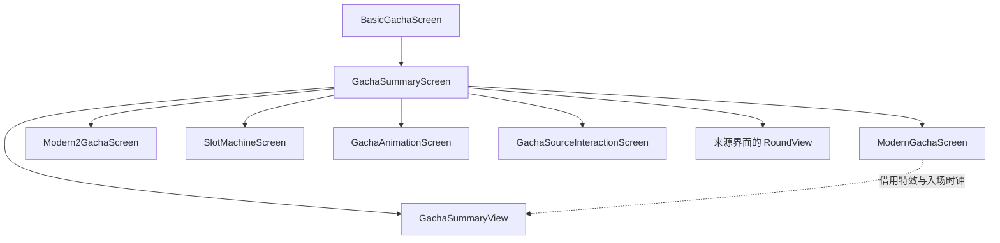

# 奖励汇总视图与演出生命周期

## 当前结构

共享层只管理固定奖励快照、完成通知、按键去重和汇总。各演出不再继承现代界面以取得这些能力。

| 所有者 | 责任 |
| --- | --- |
| BasicGachaScreen | 展示 token、原界面、合并后的奖励、自动拿取阶段及原有网络控制 |
| GachaSummaryScreen | 第一次完整快照接收、完成通知去重、共享按键、汇总入口与 Tooltip |
| GachaSummaryView | 网格布局、可见行、同步入场、裁剪、滚动、预览、汇总背景与边框失败回退 |
| ModernGachaScreen | 单物品剪影、揭晓和下一项状态 |
| Modern2GachaScreen | 并排分页、页内统一揭晓及分页输入 |
| GachaAnimationScreen | 箱子、转轮等前置演出及提交结果等待 |
| GachaSourceInteractionScreen | 来源选择、提交、多轮小总览、重排及最终总览 |
| SlotMachineScreen | 循环老虎机、停转和结果停留 |

来源交互仍由原有 loaded/hasActual 控制实际结果接收；它覆盖共享接收入口，不增加第二次提交。ClientPacketListener 的“已收到结果”检查改为共享类型，并继续调用原有虚方法判断。

## 固定快照和同步入场

共享汇总使用固定的完整奖励集合。当前内部路径在开始汇总或准备预览时已经完成奖励构建，原 summaryRevealBase 在这些入口始终等于奖励数量；依赖逐项间隔和加速的分支因此被移除，不再保留无效的 100/25ms 时间状态。

每次网格渲染仍只采样一次入场 Frame，同帧物品共享该 Frame。滚动后的入场继续调用 reset(true)，初始和切换时长仍由未修改的 ModernGachaEntrance 管理。每个网格单元的 scissor、item decoration、边框和悬浮范围保持原有几何关系。

现代2的 pageLayout、renderPageItems、renderLabels、completePage、advance 和 changePage 六个方法与提取前逐项一致；64 最小宽度、8 间隔、按长边缩放和溢出裁剪未随本次提取重写。

## 通知与输入

完成通知仍按 RewardData 去重，音效条件、自动拿取入口和播报调用继续使用原实现。动画界面在全部奖励不进入单独揭晓时，仍于完整快照接收时完成通知，保留此前继承路径的实际时机。

强制观看继续在宿主屏幕实时判断。汇总完成回调先执行，再渲染提示，避免把回调前的强制观看状态缓存为本帧提示。空格、Shift、滚动和关闭仍走相应演出的原入口或共享汇总入口。

多轮 RoundView 继续使用独立实例；其完成回调只设置 ready，返回外层后再进入下一轮，最终总览才完成外层展示。Source 的状态机、请求、反射、选择和几何方法除继承、框架空值注解外，与提取前源码一致。

## 背景资源所有权

- 现代界面将既有 ModernGachaEffect、ModernGachaEntrance 和开始时间交给汇总视图使用；视图记录借用关系，关闭时不重复销毁借用特效。
- 其他完整汇总在首次需要背景时才创建自己的 ModernGachaEffect，由视图关闭。
- 仅绘制网格的箱子结束页和小总览不额外分配汇总背景目标。
- 各前置演出的 scene、backdrop、reelFade、pageEffect 继续由原宿主关闭；本批未重写它们的内部 GL 状态恢复实现。

GachaChestAnimation、GachaTotemImpact、ModernGachaEntrance 和 GachaSceneRenderer 的文件 SHA256 均与本批开始前备份一致。950ms 箱子时序、图腾柔光冲击、曲线及场景渲染公式没有在本批改动。

## 实际检查

共享接入涉及的 12 个调用文件完成 IDEA 错误诊断，0 错误。最后对 8 个核心修改文件读取完整诊断，全部 analyzed、无截断，0 错误、19 个警告。警告包括既有空值、整数除法、未使用常量、等价写法建议，以及跨模块 Mixin 配置关联提示；未通过改变几何、强行改写表达式或抑制注解来消除这些提示。

源码中无演出继续 extends ModernGachaScreen，也无旧逐项汇总间隔、加速状态命中。现代的五个主要单物品方法，经完成通知入口名称归一后与提取前一致；来源状态机和现代2六个方法亦已逐项核对。

本批未执行编译、Data、测试或游戏，不能宣称视觉、键鼠交互、显卡状态或资源释放在运行时已验收。场景渲染器自身的职责拆分、布局快照和持久化窗口仍在后续批次。

## 备份与中断记录

提取前备份：patches/refactor-baseline-20261020-212848-033，共 673 文件。接入完成后的删除检查点：patches/refactor-baseline-20261020-215156-445，共 675 文件，包含新共享类型，随后只删除无引用的预览默认重载和两个提取过程中产生的按键包装。

上一轮大补丁因上下文不匹配，0 操作应用后停止并报告。本轮重新读取当前原文，改用有序且不重叠的方法补丁接入。自动审批曾拦截包含 undefined 的生成补丁；改为明确删除行后通过。另一次回调插入因疑似重复被拦截，重读确认无声明后只插入一次。上述失败没有被描述成已应用的修改。

两次备份的 HEAD 与原索引校验保持一致；没有提交或重置既有暂存内容。

